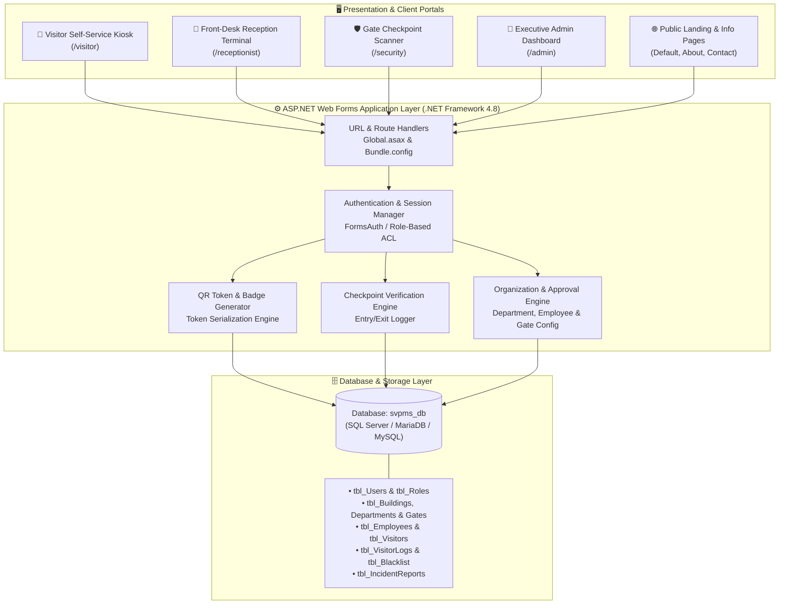
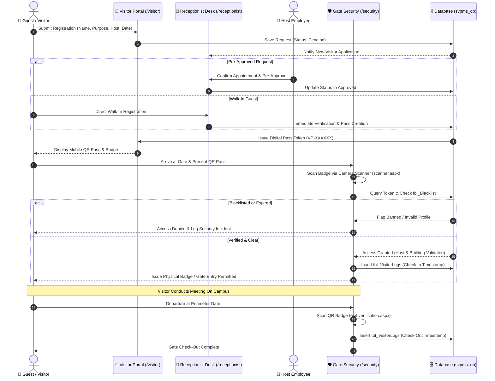
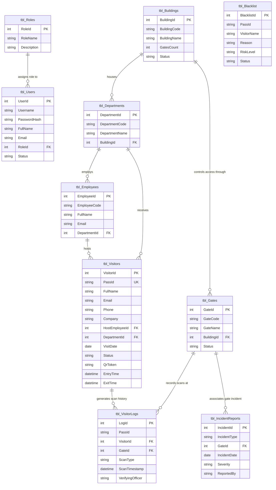
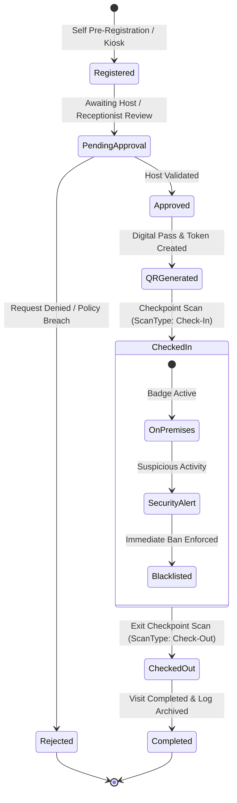

# 🏢 Smart Visitor Pass Management System (SVPMS)

[](https://dotnet.microsoft.com/)
[](https://www.mysql.com/)
[](https://getbootstrap.com/)
[](#-security-operations--gate-control-security)
[](#-project-contributors)

An enterprise-grade, multi-tier **Visitor Access & Campus Gate Security Solution** engineered with **ASP.NET Web Forms**, **SQL Database**, **Bootstrap 5**, and modern **JavaScript**. Designed for high-throughput corporate headquarters, universities, IT parks, and restricted-access facilities.

---

## 📑 Table of Contents
- [System Architecture](#-system-architecture)
- [Visitor Access & Verification Workflow](#-visitor-access--verification-workflow)
- [Database Entity Relationship Model](#-database-entity-relationship-model)
- [Visitor Pass Lifecycle](#-visitor-pass-lifecycle)
- [Core Functional Modules](#-core-functional-modules)
  - [1. Administration & System Management (`/admin`)](#1-administration--system-management-admin)
  - [2. Receptionist Front-Desk Operations (`/receptionist`)](#2-receptionist-front-desk-operations-receptionist)
  - [3. Security Operations & Gate Control (`/security`)](#3-security-operations--gate-control-security)
  - [4. Visitor Self-Service Portal (`/visitor`)](#4-visitor-self-service-portal-visitor)
- [Project Directory Structure](#-project-directory-structure)
- [Installation & Getting Started](#-installation--getting-started)
- [Project Contributors](#-project-contributors)

---

## 🏛️ System Architecture

The following diagram illustrates the multi-tier architectural layout, role separation, and communication boundaries across the platform:



---

## 🔄 Visitor Access & Verification Workflow

The sequence diagram below outlines the full lifecycle of a visitor request—from initial pre-registration to gate checkpoint validation and departure logging:



---

## 🗄️ Database Entity Relationship Model

The schema (`database_schema.sql`) maintains relational integrity across organizational units, staff members, visitors, and security audit logs:



---

## 🚦 Visitor Pass Lifecycle



---

## 🧩 Core Functional Modules

### 1. Administration & System Management (`/admin`)
- **Executive Analytics Dashboard** (`dashboard.aspx`): Visual metrics on daily footfall, active visitors on-premises, department utilization, and gate throughput.
- **Organization Hierarchy** (`departments.aspx`, `buildings.aspx`, `gates.aspx`): Campus configuration including zones, multi-gate setups, and departmental directories.
- **Staff Roster Management** (`employees.aspx`): Manage internal host employees available for visitor appointments.
- **Visitor Governance** (`visitors.aspx`, `visitor-details.aspx`, `approvals.aspx`): Administrative approval queues, historical visit directories, and detailed guest dossiers.
- **Security Blacklist & Compliance** (`blacklist.aspx`, `logs.aspx`, `reports.aspx`): Manage facility-wide bans, real-time activity audit trails, and downloadable PDF/Excel compliance reports.

### 2. Receptionist Front-Desk Operations (`/receptionist`)
- **Reception Command Hub** (`dashboard.aspx`): Real-time queue tracker, pending guest check-ins, and active appointments.
- **Walk-in Onboarding** (`register-visitor.aspx`, `walk-in.aspx`): Rapid visitor intake, photo ID capture, and host employee matching.
- **Badge Printing & QR Passes** (`generate-qr.aspx`, `print-badge.aspx`): Immediate issuance of thermal/paper visitor badges with encrypted QR codes.
- **Schedules & Rosters** (`today-visitors.aspx`, `upcoming-visitors.aspx`): Time-slotted visitor calendar to prevent front-desk congestion.

### 3. Security Operations & Gate Control (`/security`)
- **QR Checkpoint Scanner** (`scanner.aspx`): Browser-based camera scanner for touchless QR badge inspection at perimeter checkpoints.
- **Entry & Exit Verification** (`entry-verification.aspx`, `exit-verification.aspx`): Multi-point identity validation verifying building clearance and expiration status.
- **Live Premises Monitor** (`live-visitors.aspx`, `visitor-search.aspx`): Real-time head-count of all external visitors currently on campus.
- **Incident Escalation & Blacklist Enforcement** (`incident-report.aspx`, `blacklist.aspx`): Fast incident documentation with severity flags and immediate gate-level pass revocation.

### 4. Visitor Self-Service Portal (`/visitor`)
- **Touchless Pre-Registration** (`register.aspx`): Self-service pre-booking from any mobile device or external browser.
- **Digital QR Pass** (`qr-pass.aspx`): Secure mobile pass displaying visitor photo, host name, valid hours, and scannable QR token.
- **Real-Time Status Tracker** (`status.aspx`): Check pass approval status using Pass ID (e.g. `VP-264025`).
- **Document Uploader & Help Desk** (`upload-documents.aspx`, `help.aspx`): ID document verification upload and interactive visitor FAQ.

---

## 📂 Project Directory Structure

```text
main.site/
│
├── main.site.slnx                  # Visual Studio Solution File
├── .gitignore                      # Git Ignore Configuration
├── README.md                       # Comprehensive Documentation
│
└── main.site/                      # Core Web Application Root
    ├── database_schema.sql         # SQL Database Schema & Seed Data
    ├── Web.config                  # ASP.NET Application Configuration
    ├── Global.asax                 # Application Lifecycle Events
    ├── packages.config             # NuGet Package Dependencies
    │
    ├── admin/                      # 👑 Administration Module
    │   ├── dashboard.aspx          # Executive KPIs & Charts
    │   ├── departments.aspx        # Department Directory
    │   ├── employees.aspx          # Host Employee Roster
    │   ├── buildings.aspx          # Campus Building Config
    │   ├── gates.aspx              # Gate Checkpoints Config
    │   ├── visitors.aspx           # Master Visitor List
    │   ├── approvals.aspx          # Approval Workflow Engine
    │   ├── blacklist.aspx          # Facility Blacklist Control
    │   ├── logs.aspx               # System Audit Trail
    │   └── reports.aspx            # Exportable Compliance Reports
    │
    ├── receptionist/               # 🏨 Front-Desk Reception Module
    │   ├── dashboard.aspx          # Front-Desk Intake Queue
    │   ├── register-visitor.aspx   # Visitor Check-In Form
    │   ├── walk-in.aspx            # Walk-in Fast Check-In
    │   ├── today-visitors.aspx     # Today's Scheduled Guests
    │   ├── upcoming-visitors.aspx  # Future Bookings Calendar
    │   ├── generate-qr.aspx        # Digital QR Pass Generator
    │   └── print-badge.aspx        # Physical Badge Printing
    │
    ├── security/                   # 🛡️ Security Operations Module
    │   ├── dashboard.aspx          # Gate Telemetry & Checkpoints
    │   ├── scanner.aspx            # Camera-Based QR Code Reader
    │   ├── entry-verification.aspx # Inbound Gate Verification
    │   ├── exit-verification.aspx  # Outbound Gate Verification
    │   ├── entry-logs.aspx         # Check-In Scan Audit
    │   ├── exit-logs.aspx          # Check-Out Scan Audit
    │   ├── live-visitors.aspx      # Live On-Premises Count
    │   ├── visitor-search.aspx     # Rapid Directory Search
    │   └── incident-report.aspx    # Security Incident Logging
    │
    ├── visitor/                    # 📱 Self-Service Visitor Portal
    │   ├── index.aspx              # Visitor Portal Home
    │   ├── register.aspx           # Self Pre-Registration
    │   ├── status.aspx             # Real-Time Pass Status Check
    │   ├── qr-pass.aspx            # Mobile Pass View
    │   ├── upload-documents.aspx   # ID Document Upload
    │   └── help.aspx               # Guest Help Desk & FAQs
    │
    ├── assets/                     # 🎨 UI & Design Assets
    │   ├── css/                    # Modular Stylesheets
    │   │   ├── variables.css       # Design Tokens & Theme Colors
    │   │   ├── style.css           # Base Styles
    │   │   ├── layout.css          # Grid & Portal Layout
    │   │   ├── dark-mode.css       # High-Contrast Dark Theme
    │   │   ├── dashboard.css       # Analytical Dashboard Charts
    │   │   └── visitor.css         # Mobile Pass Styles
    │   └── js/                     # Modular JavaScript
    │       ├── admin.js            # Admin Automation & Charts
    │       ├── receptionist.js     # Front-Desk Event Handlers
    │       ├── security.js         # Gate Verification & Telemetry
    │       ├── visitor.js          # Pass Rendering & Validation
    │       └── theme.js            # Light/Dark Theme Switcher
    │
    └── App_Start/                  # Application Startup Bundles
        ├── BundleConfig.cs         # Script & CSS Bundling
        └── RouteConfig.cs          # Friendly URL Routing
```

---

## 🚀 Installation & Getting Started

### Prerequisites
- **Visual Studio 2022** (with *.NET desktop & web development* workload)
- **.NET Framework 4.8 Runtime & Developer Pack**
- **Database Engine**: Microsoft SQL Server / MariaDB / MySQL 8.0+
- **Browser**: Modern Chromium/WebKit browser with camera access (for QR Scanner)

### Step 1: Clone the Repository
```bash
git clone https://github.com/jaimiltrived/.netwebsite.git
cd .netwebsite
```

### Step 2: Database Initialization
1. Open your database management tool (SSMS, phpMyAdmin, or MySQL Workbench).
2. Execute the provided script located at:
   ```text
   main.site/database_schema.sql
   ```
3. The script creates the `svpms_db` schema, tables with foreign key constraints, and default seed data.

### Step 3: Connection String Setup
In `main.site/Web.config`, update your connection string under `<connectionStrings>`:
```xml
<connectionStrings>
  <add name="SVPMS_DB" 
       connectionString="Server=localhost;Database=svpms_db;Uid=root;Pwd=yourpassword;" 
       providerName="System.Data.SqlClient" />
</connectionStrings>
```

### Step 4: Build & Run
1. Open `main.site.slnx` (or `main.site/main.site.csproj`) in Visual Studio.
2. Restore NuGet dependencies:
   ```bash
   nuget restore
   ```
3. Press **`F5`** or click **IIS Express** to build and launch the application.

---

## 👥 Project Contributors

| Contributor | GitHub Profile | Contributions | Core Responsibility |
|:---|:---|:---:|:---|
| **Jaimil Trivedi** | [@jaimiltrived](https://github.com/jaimiltrived) | **23 Commits** | **System Architect & Lead**: Core Framework, Database Schema, Web.config, Master Layouts, Admin Module Governance & Platform Lifecycle |
| **Anas Shaikh** | [@anasshaikhh2006-lgtm](https://github.com/anasshaikhh2006-lgtm) | **13 Commits** | **Receptionist & Visitor Systems**: Front-Desk Reception Portal, QR Pass Engine, Walk-in Check-in, Visitor Self-Service Kiosk & CSS Theme Design |
| **Uramani** | [@uramani438-jpg](https://github.com/uramani438-jpg) | **7 Commits** | **Security Operations**: Checkpoint Scanner, Entry/Exit Dual Verification, Live Visitor Tracking, Gate Audit Logs & Security Incidents |

---

<div align="center">
  <sub>Developed for Smart Visitor Pass Management & Campus Physical Security Compliance.</sub>
</div>
